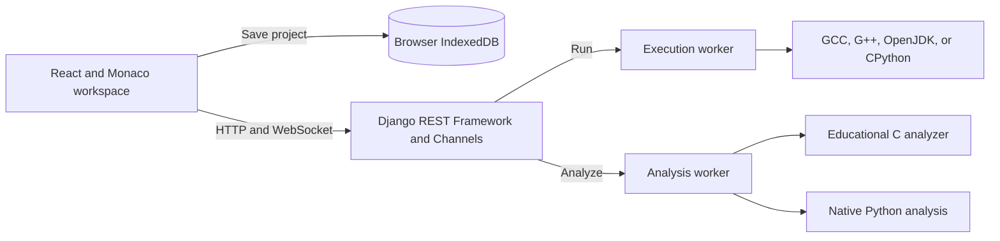

# ARCLIS architecture

The workspace has two paths from source text. **Run** executes a submitted
project with a native toolchain. **Analyze** returns phase artifacts for the
active C or Python buffer. Both paths use short-lived, bounded containers in
the local development profile.

| Directory | Responsibility |
| --- | --- |
| [`frontend/`](../frontend/) | React and Vite workspace, Monaco buffers, xterm console, browser persistence, and Playwright tests |
| [`backend/`](../backend/) | Django, Django REST Framework, Channels routing, request validation, session ownership, workers, and backend tests |
| [`compiler_engine/`](../compiler_engine/) | Flex scanner, Bison grammar, C passes, CLI drivers, and fixtures |
| [`docker/`](../docker/) | Native execution and analyzer images and their trusted launchers |
| [`deployment/`](../deployment/) | Restricted HTTPS/WSS Compose profile and smoke check |
| [`examples/`](../examples/) | Academic demonstration source files |

Quick Run chooses a toolchain and canonical filename from the language
selector and submits that single source file. Projects use the open runnable
source as the entry file and fall back to the saved entry from a header or
closed editor. The entry chooser opens the selected source.
Run and Analyze capture the current Monaco model before making the request.
Source-linked diagnostics reference that snapshot. IndexedDB preserves Quick
Run drafts separately from the existing project record, which stores files,
folders, tabs, and the entry selection. Browser settings retain layout and
editor preferences.
The backend does not use SQLite to store browser projects or execution sessions.

## Language coverage

| Language | Run toolchain | Analyze |
| --- | --- | --- |
| C | GCC in C17 mode | Custom Flex and Bison front end, AST, semantics, symbol table, and three-address IR |
| C++ | G++ in C++17 mode | Native compiler diagnostics through Run |
| Java | OpenJDK 21 `javac` and `java` | Native compiler diagnostics through Run |
| Python | CPython 3.12 | Native `tokenize`, `ast`, `symtable`, and compiler checks |

Python analysis compiles for diagnostics without executing source or importing
modules from it. It has no educational IR pass. [CPython symbol table documentation](https://docs.python.org/3.12/library/symtable.html)

## Educational C phases

1. [`lexer.l`](../compiler_engine/c/lexer.l) specifies token rules for Flex.
   The scanner emits lexemes and source ranges, skips comments and whitespace,
   and reports lexical diagnostics. [Flex scanner manual](https://westes.github.io/flex/manual/Introduction.html)
2. [`parser.y`](../compiler_engine/c/parser.y) defines the Bison grammar and
   AST construction actions. Precedence is expressed as grammar levels, with
   an explicit nearest-`if` resolution for `else`. The generated parser is
   reentrant and recovers at semicolons. [GNU Bison manual](https://www.gnu.org/software/bison/manual/)
3. [`ast.c`](../compiler_engine/c/ast.c) owns source-located nodes. The AST
   preserves expression grouping, declared types, statement structure, and
   locations used to navigate from the inspector back to Monaco.
4. [`semantic.c`](../compiler_engine/c/semantic.c) and
   [`symbol_table.c`](../compiler_engine/c/symbol_table.c) walk declarations
   in source order, resolve scopes and compatible redeclarations, and check
   operands, assignments, call arguments, control conditions, and returns.
5. [`ir.c`](../compiler_engine/c/ir.c) lowers valid C subset programs into
   three-address instructions with stable symbols, temporaries, labels, and
   branches. Logical operators branch around the right operand when the left
   determines the result. The IR is displayed as analysis data. GCC compiles
   and runs the original source independently.

### Grammar coverage

| Area | Supported |
| --- | --- |
| Types and declarations | `int`, `float`, `double`, `char`, `void`, optional `static`, simple named declarators with optional initializers, comma-separated declarations, function prototypes and definitions |
| Statements | Blocks, expression and empty statements, `if`/`else`, `while`, `for`, and `return` |
| Expressions | Identifiers, numeric, character and string literals, grouping, calls, increments and decrements, arithmetic, comparisons, logical operations, simple and compound assignments, and the comma operator |
| Translation unit | File-scope declarations and simple quoted or angle-bracket `#include` tokens. Includes are retained without loading header contents. |

Pointers, arrays, casts, aggregates, `switch`, `break`, `continue`, variadic
declarations, macro expansion, and full C type and control-flow rules are
outside the educational subset. For example, an included standard header
does not introduce declarations into the custom symbol table. A compatible
explicit prototype in [the C demo](../examples/compiler_phases.c) makes
`putchar` visible to the analyzer. GCC supplies the native library at Run time.

Ranges use zero-based byte offsets and one-based lines and UTF-8 byte columns,
with an exclusive end. Monaco needs UTF-16 positions, so the frontend maps
offsets against the submitted snapshot. The CLI exposes JSON Lines and supports
1 MiB of AST input, 4,096 nodes, and a depth of 128. The HTTP analyzer caps the
source at 64 KiB. [CLI commands and record formats](../README.md#run-the-educational-c-syntax-analyzer-in-wsl)

## HTTP and WebSocket contract

| Endpoint | Request and successful response |
| --- | --- |
| `GET /api/v1/health/` | `200` with `{"status":"ok"}`. `HEAD` returns the status and headers without a body. |
| `GET /api/v1/capabilities/` | `200` with `languages`, `execution.available`, `execution.interactive`, and `analysis.available`. Available analysis includes `analysis.languages`. |
| `POST /api/v1/executions/` | JSON `language`, `entry_file`, and `files` of `{path, content}`. Java uses `main_class`. Optional `stdin` queues initial input. `interactive` defaults to `true`. Response `201` supplies `id`, `owner_token`, `websocket_path`, and `expires_in`. |
| `POST /api/v1/analysis/` | JSON `source` and optional `language` (`c` by default or `python`). Response `200` includes `syntax_valid`, `semantic_valid`, `tokens`, `ast`, `scopes`, `symbols`, `diagnostics`, and `ir`. Source diagnostics can appear in a successful report. |
| `/ws/executions/<id>/` | An allowed browser origin and subprotocols `arclis.v1` and `owner.<owner_token>` claim one execution. The server selects `arclis.v1`. |
| `/ws/health/` | Available in the restricted deployment. It accepts the allowed origin, sends `{"status":"ok"}`, and closes with code `1000`. |

The execution WebSocket accepts `{"type":"stdin","data":"7\n"}`,
`{"type":"eof"}`, and `{"type":"cancel"}`. It streams `status`,
`stdout`, `stderr`, `diagnostics`, and `error` packets. One terminal `result`
reports the final state, `exit_code`, and `execution_time_ms`. Exit code can be
null if no native process exit was available. An optional positive safe
integer `request_id` on stdin and EOF messages requests `input_ack` on
acceptance or a correlated `stdin_rejected` error. The browser echoes the
input in the terminal while it is edited and sends a line on Enter. The
line becomes part of the transcript after the worker's input queue accepts it.
The worker sends input to the program through standard streams. The browser
console supports line editing and EOF over those streams, with a 30-second
inactivity limit. Worker startup can return `worker_unavailable` with a safe
setup message. The capabilities endpoint reports feature availability for the
client, and each job verifies Docker and its isolation settings at startup.
The owner token belongs in the
subprotocol header and should be kept out of URLs and logs.

DRF errors use `{"error":{"code":"...","details":{...}}}`. Relevant status
codes are `400` for invalid JSON or input, `403` for a disallowed origin, `404`
for a disabled feature, `413` for an oversized JSON body, `422` for an analysis
resource limit, and `429` for an exhausted local slot. Session and analysis
responses carry `Cache-Control: no-store`. Execute accepts 2 MiB of JSON and
Analyze accepts 512 KiB of JSON, with separate UTF-8 source limits.

## Execution and security boundaries

The API validates workspace paths, files, byte counts, entry point, and input
before a job reaches Docker. An in-memory registry expires an unclaimed
session after 30 seconds and allows one valid claim. A single backend process
admits eight pending sessions and two active execution jobs. Analysis has one
separate slot. Java sessions compile with annotation processing disabled.

The worker stages a private temporary input tree and mounts it read-only. Its
configured rootless daemon provides cgroup v2 limits, seccomp, and a container
network with only loopback. Each job runs as UID/GID 65534 with no capabilities,
privilege escalation, host Docker socket, or inherited host environment. The
root filesystem is read-only and scratch space uses bounded tmpfs. The worker
removes the container and workspace on completion, cancellation, and bounded
failure paths. A persistent cleanup failure is visible in the server log.

Execution limits include one CPU, 256 MiB RAM (384 MiB for Java), zero swap,
64 processes, 32 MiB scratch, and 256 KiB combined output. Interactive input
allows 4 KiB per message and 64 KiB per job. Compile, runtime, and inactivity
deadlines bound stalled sessions. Analysis has its own five-second deadline
and 2 MiB output cap.

The local worker shares the host's Linux kernel, and admission is per backend
process. The restricted HTTPS profile publishes loopback ports only, isolates
Uvicorn on a private network, and disables submitted execution and analysis.
Public workers need dedicated infrastructure, a stronger isolation evaluation,
and deployment-level admission and monitoring. [Measured local worker controls](../README.md#s22-worker-audit)
